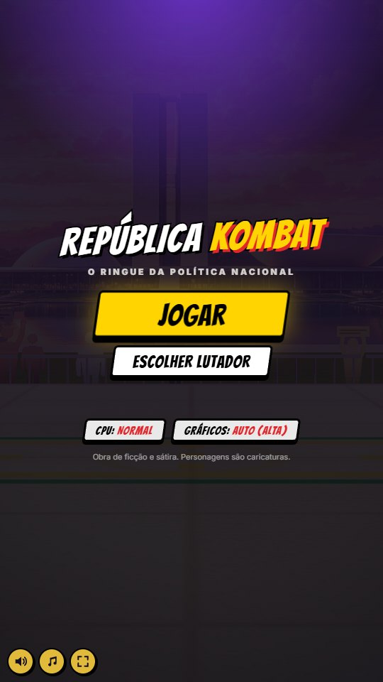
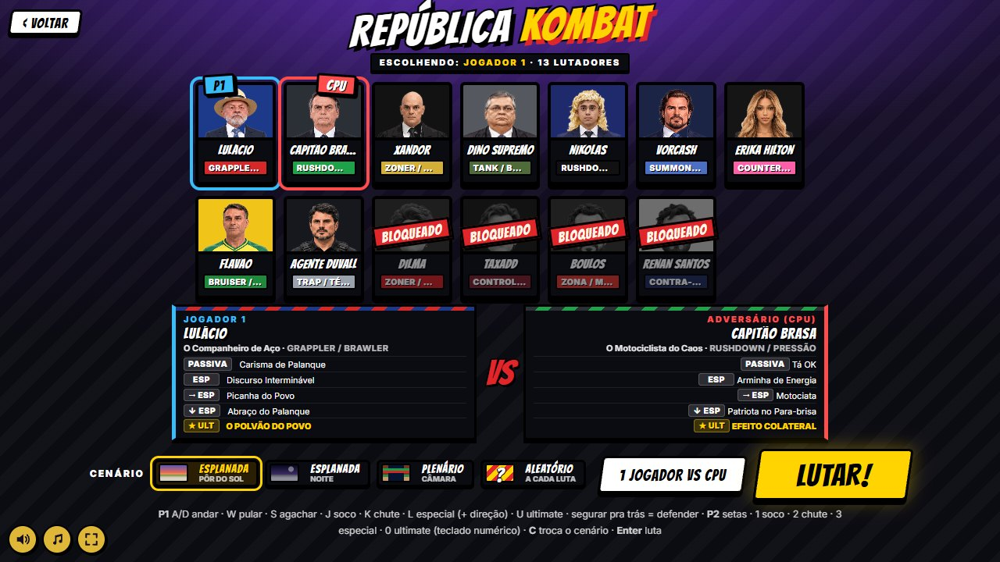
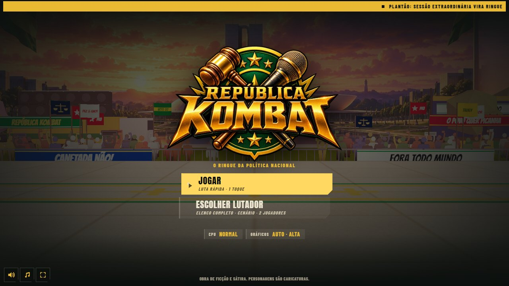
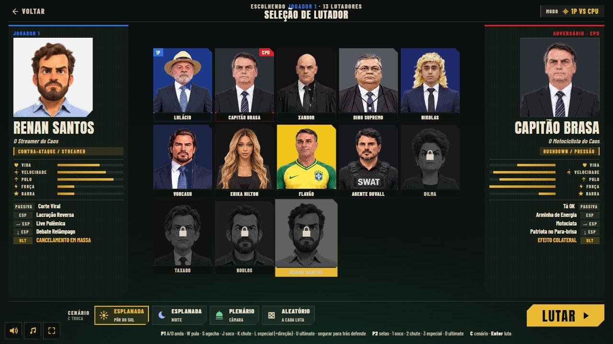
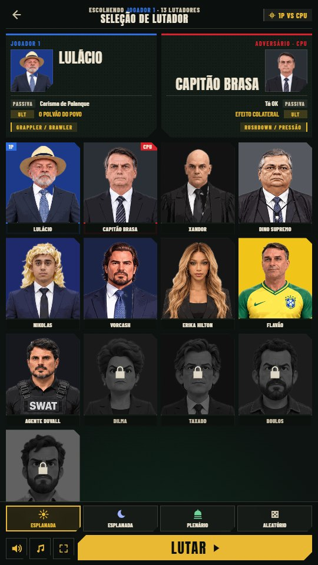
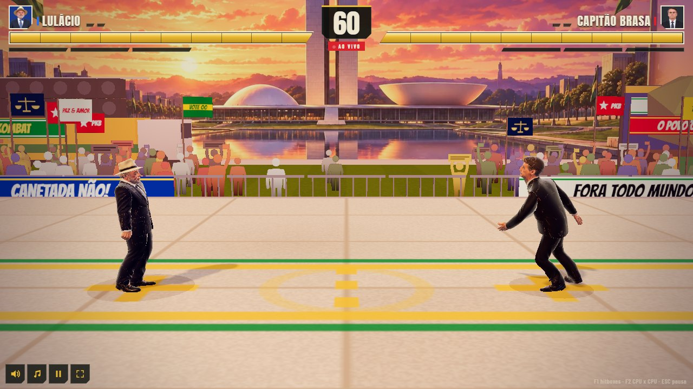
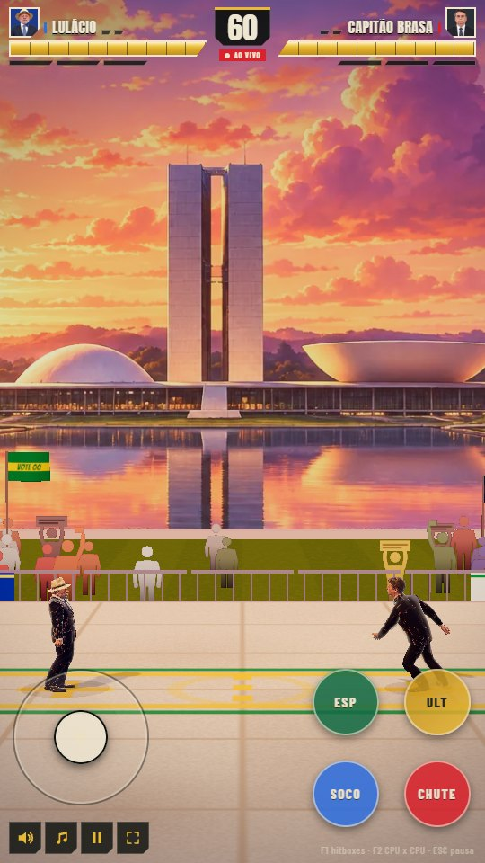
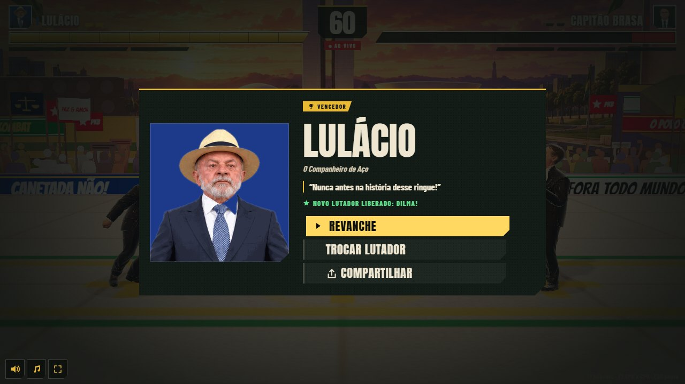

# UI_DIRECAO.md — Direção de arte da interface (República Kombat)

> Documento normativo da UI (telas, HUD, tipografia, movimento). O visual 3D continua em `ARTE.md`; esta direção substitui o §5 antigo.
> Queixa que originou o trabalho: *"o menu está com muita cara de IA"*. Objetivo: UI de jogo de luta de estúdio grande, com identidade própria.

## 1. Referências (o que estudamos e o que levamos)

| Jogo / fonte | O que levamos | Link |
|---|---|---|
| **Street Fighter 6** | Seleção em grade de rostos com o lutador em pose grande ao lado; tipografia display própria + fonte condensada para o resto; grafite/stencil como textura, não como enfeite | [TCRF – SF6 UI design](https://tcrf.net/Prerelease:Street_Fighter_6/UI_Design) · [EventHubs – select SF5 vs SF6](https://www.eventhubs.com/news/2023/feb/16/sf5-sf6-character-select-screens/) |
| **Tekken 8** | Barra de vida com dano recuperável em cinza/vermelho atrasado, round marcado em cima da barra, nome embaixo do retrato, HUD sempre no mesmo lado do jogador; opção de HUD em primeiro plano | [Tekken wiki – Health](https://tekken.fandom.com/wiki/Health) · [Patch 1.09.01](https://www.bandainamcoent.com/news/tekken-8-patch-notes-v1-09-01) |
| **Mortal Kombat 1** | Barras rebaixáveis para perto do foco, feedback sonoro por limiar de vida (75/50/25 %) — acessibilidade como parte do HUD | [MK1 Accessibility](https://mortalkombatgamessupport.wbgames.com/hc/en-us/articles/19435787154963-Mortal-Kombat-1-Accessibility-Features-A11Y) |
| **Guilty Gear Strive** | Combo counter grande mas fora do centro; nome do golpe em faixa | [Wikipedia – GG Strive](https://en.wikipedia.org/wiki/Guilty_Gear_Strive) |
| **Persona 5** | Uma cor dominante e sem sub-cores; preto/branco invertidos; itens de menu alinhados em oblíqua; linhas que guiam o olho; modelo em pose nos menus | [Siliconera – design secrets](https://www.siliconera.com/atlus-reveals-design-secrets-behind-persona-5s-distinctive-ui/) · [Persona Central – painel](https://personacentral.com/persona-5-panel-concept-development-ui/) · [Medium – P5R visual design](https://medium.com/game-design-fundamentals/visual-design-of-games-practice-analysis-of-persona-5-royal-61a5c18ba9c1) |
| **Smash Ultimate / Sony (God of War, Spider-Man)** | Menu em lista vertical com cursor, hierarquia por tamanho e não por cor, acabamento: hairlines, grão, movimento curto e seco (120–250 ms) | [Interface In Game – God of War](https://interfaceingame.com/games/god-of-war/) · [Interface In Game – Spider-Man](https://interfaceingame.com/games/marvels-spider-man/) |
| **"Cara de IA"** (o que evitar) | Gradiente roxo→azul, cantos arredondados iguais em tudo, cards dentro de cards, sombra mole + glow, emoji como ícone, neon sobre escuro, headline gigante com fonte "divertida" em tudo | [vibecodekit – AI slop design](https://vibecodekit.dev/ai-slop-design) · [braingrid – design systems for AI coding](https://www.braingrid.ai/blog/design-system-optimized-for-ai-coding) · [Medium – why AI UI feels generic](https://medium.com/@cssamithpitigala/why-ai-generated-ui-looks-good-but-often-feels-generic-020a9b1b8492) |

## 2. Diagnóstico do UI anterior (prints em `docs/ui/antes_*.jpg`, contact sheet em `videos/v6/ui_antes_depois.jpg`)

 

O que entregava "template de IA":
1. **Fundo roxo em gradiente radial** com "listras" diagonais claras — o cliché neon-sobre-escuro.
2. **Bangers em tudo** (logo, botões, nomes, listas, HUD): fonte cômica usada como fonte de sistema; `-webkit-text-stroke` preto grosso até em texto de menu, longe do 3D.
3. **Mesmo card para tudo**: borda preta 3–4 px + sombra dura + cantos arredondados + skew — cards dentro de cards (painel dos escolhidos com lista dentro de card dentro de tela).
4. **Logo em texto** com contorno e sombra, quando já existia o logo em arte (`art/ui/logo.png`).
5. Seleção sem **herói**: 13 retratos iguais, sem lutador grande, sem atributos, nome pequeno.
6. Tela VS pequena e tímida; pausa e resultado como "modal de site".
7. Sem **cursor de menu** nem navegação por setas (teclado/controle); foco invisível.
8. Botões de som/sistema amarelos redondos "de app".

## 3. Direção de arte: "Diário Oficial do ringue"

Frase-guia: **plantão de telejornal dentro de um prédio público dos anos 60.** Verde-tinta e ouro-velho do protocolo oficial, papel-ofício, chanfros de concreto (Brasília), carimbo vermelho — tudo sóbrio e pesado, para a sátira vir dos lutadores e não da moldura.

### 3.1 Paleta (`src/style.css :root`)
| Token | Hex | Uso |
|---|---|---|
| `--ink` / `--ink2` / `--ink3` | `#0b0f0d` / `#141c18` / `#1f2a24` | fundo, painéis, painel em destaque |
| `--paper` / `--paper2` | `#efe6d2` / `#cfc4ab` | texto principal / secundário, bordas de vida |
| `--gold` / `--gold2` / `--gold-hi` | `#e9b933` / `#c08f1c` / `#ffd862` | ação principal, vida, cursor, filetes |
| `--green` / `--green2` | `#126b45` / `#0a3b29` | acentos e luz de fundo da seleção (nunca como texto grande) |
| `--blue` / `--blue2` | `#2f6fe0` / `#173c8f` | tudo do Jogador 1 |
| `--red` / `--red2` | `#d9222c` / `#8f1118` | Jogador 2/CPU, dano, K.O., AO VIVO, bloqueio |
| `--ult` | `#b88cff` | barra de ultimate (cheia vira ouro) |

Regra: **uma cor de ação (ouro)**. Azul e vermelho só identificam lado. Verde só em superfícies. Nada de roxo/magenta fora da barra de ultimate.

### 3.2 Tipografia (2 famílias, self-hosted em `public/fonts/`, OFL)
- **Anton** (display): nomes, números, letreiros, rótulos de botão. Caixa alta, tracking +2 a +6 %. Em letreiros sobre o 3D leva contorno ≥ 3 px + sombra dura; em menus vai **limpa**.
- **Barlow Condensed** 500 / 700 / 800 (texto): kickers (800, caixa alta, tracking +14 %), listas (700), descrições (500). Nada abaixo de 10 px; corpo ≥ 12 px no celular.
- `Bangers` ficou **só** nos letreiros 3D em canvas (faixas da plateia, VFX) — não é mais fonte de UI.

### 3.3 Formas, textura, ícones
- **Chanfro** (clip-path, 8–18 px) em um ou dois cantos opostos — nunca cantos arredondados. Skew só nos letreiros de luta (K.O., LUTEM, VS).
- **Hairlines** de 1 px em `--line` separam blocos; **filete** de 3 px no topo (ouro = sistema, azul = P1, vermelho = P2).
- **Textura**: grão de papel (SVG `feTurbulence`, overlay a 45–50 %) nas telas inteiras; **retícula de jornal** (radial-gradient 5 px) nos painéis de ficha/resultado.
- **Ícones próprios** em SVG inline (`src/ui/icons.js`): seta de cursor, voltar, pausa, tela cheia, cadeado, troféu, compartilhar, CPU/2 jogadores, sol/lua/cúpula/dado (cenários), atributos (coração, corrida, pulo, raio, estrela). Zero emoji.
- **Logo** em arte (`public/assets/ui/logo.webp`, 1024 px + versão 512 px via `srcset`), com `drop-shadow` e nada mais.

### 3.4 Movimento
- Easing único `cubic-bezier(.2,.9,.25,1)`; durações 150–250 ms (foco, cursor), 450–550 ms (entradas de tela). Sem bounce em menu; bounce só no VS e nos letreiros de luta.
- Entrada em cascata no título (logo → subtítulo → menu → opções, 100 ms de passo). `prefers-reduced-motion` desliga tudo.
- **Foco** = 3 sinais ao mesmo tempo: seta de cursor aparece, fundo clareia, bloco desliza 6 px. Nunca só glow.
- Som de UI reaproveita o banco (`src/audio/sfxBank.js`): `pen` ao mover o cursor na grade, `paper` em toggles/voltar, `stamp` ao escolher, `gavel` em LUTAR, `denied` em lutador bloqueado. A tela de título (pacote de boot, sem motor de áudio) é muda.

### 3.5 Entrada e acessibilidade
- Toque (≥ 44 px), mouse (hover = cursor), teclado/controle (setas, Enter, Esc, C). Enter sem nada focado no título ativa a opção sob o cursor ("press start").
- `focus-visible` com anel ouro de 2 px fora dos componentes que já têm estado próprio.
- Safe areas (`env(safe-area-inset-*)`) no título, HUD, seleção e rodapé fixo.
- Paisagem e retrato: grid com `grid-template-areas` muda de 3 colunas para 2; seleção em retrato tem rodapé fixo (cenário + LUTAR) e deixa 122 px livres para os botões de som.

## 4. O que foi proibido (checklist anti-template)
- [ ] gradiente roxo/azul ou neon; [ ] `border-radius` > 4 px (exceto botões de toque, que são círculos por ergonomia); [ ] sombra difusa colorida; [ ] card dentro de card; [ ] emoji; [ ] Bangers em texto de menu; [ ] contorno preto em texto fora do 3D; [ ] mais de 2 famílias; [ ] botão amarelo redondo "de app".

## 5. Especificação por tela (prints em `docs/ui/depois_*.jpg`)

### 5.1 Título (`src/ui/TitleScreen.js`, `.title`)

- Faixa de **plantão** no topo (ouro, manchetes fictícias em marquee de 46 s). Logo em arte (520 px desktop / 86 vw celular) com entrada em 700 ms. Subtítulo em kicker ouro.
- Menu em **lista com cursor**: JOGAR (bloco ouro, chanfro) e ESCOLHER LUTADOR; cada item tem rótulo (Anton 24–28 px) + dica (Barlow 800 11 px). Chips de CPU e Gráficos abaixo. Placar em números Anton quando há partidas.
- Linha de progresso de 3 px sob o menu enquanto o motor baixa; `.tload.done` esconde. Com o jogo pronto (`.title.live`) o fundo abre para o cenário 3D ao vivo (8c de alpha + vinheta).
- Rodapé: aviso "Obra de ficção e sátira" sempre visível.

### 5.2 Seleção de lutador (`src/ui/SelectScreen.js`, `.select`)
 
- Cabeçalho: voltar · kicker "Escolhendo JOGADOR 1 · 13 lutadores" + "SELEÇÃO DE LUTADOR" · chip de modo (1P vs CPU / 2 jogadores).
- **Ficha P1 (esquerda) e P2/CPU (direita)**: retrato grande chanfrado, nome Anton 28–42 px, título em itálico, arquétipo em kicker ouro, **5 barras de atributo** (vida, velocidade, pulo, força, barra — normalizadas pelo elenco), passiva + 3 especiais + ultimate. A ficha do lado que está escolhendo mostra o lutador **sob o cursor** (pré-visualização), e só troca de verdade ao confirmar.
- **Grade 5 colunas** (4 no celular), cards 4:5 com retrato, nome em faixa, selo 1P (azul) / CPU·2P (vermelho), cadeado para bloqueados. Hover/foco = escala 1.06 + moldura ouro + faixa ouro.
- Setas andam na grade, Enter escolhe, C troca cenário, Esc volta. Cartões de cenário (ícone + nome + sub) em radiogroup; LUTAR é o maior elemento (ouro, chanfro duplo, ícone play).
- Bloqueado: diálogo com cadeado vermelho e dois itens de menu com cursor (ASSISTIR ANÚNCIO / AGORA NÃO) — mesmo contrato de `src/platform` (`onUnlock`).

### 5.3 Tela VS (`src/ui/Overlays.js FightLoading`, `.fightload`)

- Dois painéis em diagonal (azul P1 / vermelho P2) entrando de cada lado em 550 ms; retrato grande; nome Anton até 92 px no rodapé do painel com kicker "Jogador 1 / CPU" e título. "VS" ouro carimba no centro (scale 2.2 → 1, −2°). Rodapé: cenário escolhido + linha de progresso + "Preparando o ringue". Retrato: painéis empilhados.

### 5.4 HUD (`src/ui/Hud.js`, `.hud`)

- Vida: barra chanfrada com borda papel 2 px, preenchimento ouro, **faixa vermelha atrasada** (segura 22 frames e escorre a 1,1 %/frame), ticks de 10 %, flash branco ao levar dano, vermelha piscando abaixo de 30 %.
- Retrato chanfrado no canto externo, nome em Anton com aba azul/vermelha, marcadores de round (ouro quando ganho), barra de ultimate em 3 segmentos violeta → ouro pulsando com etiqueta ULTIMATE, barra de recurso (CAPITAL) quando existe.
- Centro: timer Anton 50 px em placa com filete ouro, chip AO VIVO. Letreiros: TURNO (ouro + faixa escura), LUTEM! (papel + sombra vermelha), K.O. (vermelho com contorno papel + tremor), nome do ultimate com faixas de cinema. Combo: número ouro + etiqueta HITS em papel.

### 5.5 Pausa e resultado (`src/ui/Overlays.js PauseMenu`, `Hud.showResult`)

- Pausa: fundo escurecido com listras finas diagonais, painel com kicker "Sessão suspensa", PAUSA em Anton 56 px, lista com cursor (CONTINUAR em ouro, SAIR DA LUTA), dicas de tecla.
- Resultado: painel largo com retrato do vencedor à esquerda, selo "Vencedor" com troféu, nome até 72 px, título, frase em citação com filete ouro, aviso de lutador liberado, lista REVANCHE / TROCAR LUTADOR / COMPARTILHAR. Retrato: empilhado.

### 5.6 Toque e sistema (`src/ui/Touch.js`, `systemButtons`)
- Direcional com anel papel e losango ouro no centro; botões redondos (ergonomia) chapados: SOCO azul, CHUTE vermelho, ESP verde, ULT ouro com texto tinta. Pressionado = escala 0,92 + anel papel.
- Botões de som/pausa/tela cheia: quadrados chanfrados escuros com ícone ouro (os de som vêm de `src/audio` e são re-estilizados via CSS `.rk-audio`).

## 6. Como testar
```
npx vite --port 5236 --strictPort
RK_URL=http://localhost:5236/ node tools/uiflow.mjs 540 960 videos/v6/ui_depois     # título → seleção → bloqueado → VS → luta → pausa → resultado
RK_URL=http://localhost:5236/ node tools/uiflow.mjs 1280 720 videos/v6/ui_depois
RK_URL=http://localhost:5236/ node tests/publish.mjs 540 960 videos/v6/publish
```

## 7. Pendências e assets a gerar (prompts para o ChatGPT)
1. **Render do lutador em pose na seleção** (hoje: retrato 384 px). Opção A: modelo 3D em canvas de preview (exige expor um `FighterView` sem `Match`; fora do escopo por tocar `src/fight`). Opção B (barata e AAA): PNG recortado de corpo inteiro por lutador, 1024×1536, para `public/assets/characters/<id>/pose.png`.
   *Prompt:* "Full-body vinyl action-figure render of [descrição do personagem conforme ARTE.md §2], fighting-game character-select pose, three-quarter view, matte plastic with rim light, transparent background, no text, 1024x1536, consistent camera and scale across the whole roster."
2. **Miniaturas dos cenários** (hoje: ícone SVG). 3 imagens 320×200: Esplanada pôr do sol, Esplanada noite, Plenário.
   *Prompt:* "Wide establishing shot thumbnail of a stylized Brasília-like esplanade at sunset, painted-vinyl toy-world look, no people, no real flags or logos, 320x200, strong silhouette readable at 60 px."
3. **Textura de papel-ofício** 512×512 em WebP para substituir o `feTurbulence` (menos custo de composição no celular).
   *Prompt:* "Seamless tileable scan of aged off-white official document paper with faint halftone print grain, neutral, no text, 512x512."
4. **Selo/carimbo oficial do jogo** (brasão fictício, 512×512, PNG alpha) para o canto do resultado e do VS.
   *Prompt:* "Fictional republic coat of arms as a red rubber stamp, slightly smudged ink, circular, gavel and microphone crossed, no real symbols, transparent background."
5. Sons de UI dedicados (clique de cursor, confirmar, voltar) — hoje reaproveitamos `pen`/`paper`/`stamp`/`gavel` de `sfxBank`; o time de áudio pode criar `uiMove`, `uiOk`, `uiBack`.
6. Faixa de plantão: as manchetes vivem em `TitleScreen.js` (`HEADLINES`); vale ligá-las ao desafio recebido / placar.
